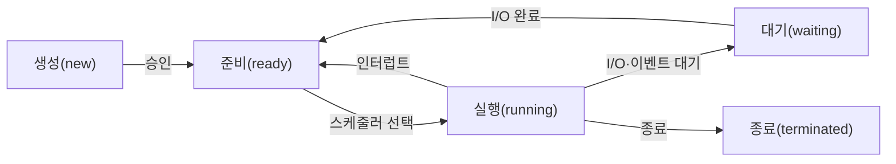

# 그림으로 설명하기

## 1. 그릴지 말지 (먼저 판단)
한 줄 테스트: **"말로만 들으면 학생이 머릿속에서 그림을 그려야 하는가?"** 설명에 `~에서 ~로`, `연결`, `위/아래`, `모양`, `거치면` 같은 표현이 반복되면 그린다.

| 내용의 모양 | 예 | 쓸 그림 |
|---|---|---|
| 원본 쪽에 그림·그래프·회로도가 있고 그게 핵심 | `(🖼 …)` 표시가 있는 쪽, "그림 3.2" | 원본 쪽 이미지 |
| 요소 3개 이상이 연결·전이·순서로 얽힘 | 상태 전이, 핸드셰이크, 처리 흐름, 트리·계층 | mermaid |
| 단계마다 상태가 바뀜 | 스택·큐 변화, 페이지 교체 | 단계별 표 (또는 mermaid) |
| 값의 변화·함수 모양 | 주파수 응답, 분포, 파형, 이산 신호 | 원본에 그 그래프가 있으면 원본 쪽 이미지, 없거나 값을 바꿔 보여줘야 하면 계산 그래프(` ```plot `) |

**그리지 않는다:** 정의, 2~3개 항목 비교(→ 표), 수식 유도(→ LaTeX), 그림이 글에 없는 정보를 하나도 더하지 않을 때.
**양:** 질문 답변엔 많아야 1~2개, 요약은 절마다 최대 1개. 그림은 글을 대신하지 않고 **글 바로 뒤에서 확인시켜 주는** 자리에 둔다.

## 2. 어디서 가져올지 (우선순위)
1. **원본 쪽 이미지 (PDF만)** — 출처 그대로라 가장 정확하다. 형식 (한 줄 단독으로):
   `[[원본: 파일명.pdf p.N | 이 그림에서 볼 것 한 줄]]`
   - 파일명은 `materials/`의 원본 이름 그대로, N은 texts의 `## [p.N]` 번호.
   - 넣기 전에 `python tools/render.py "materials/과목/파일.pdf" N`으로 **그 쪽을 직접 보고** 정말 그 그림이 있는지 확인한다.
   - 쪽 전체가 나오므로 설명에 "왼쪽 아래 그래프"처럼 볼 위치를 알려준다.
   - PPTX·DOCX는 이 형식이 안 된다 → mermaid로 그리거나 출처만 단다.
2. **mermaid 다이어그램** — 원본에 그림이 없는데 구조를 보여줘야 할 때. 노드·화살표의 내용은 전부 강의자료에서 온 것이어야 하고, 그림 바로 아래 줄에 출처를 단다. 원본 그림을 다시 그린 게 아니면 `(직접 그린 그림 — 강의자료 원본 아님)`을 붙인다.
3. **계산 그래프 (` ```plot `)** — 식이 자료에 있고 모양을 봐야 이해될 때 (아래 5절). 앱이 값을 계산해 그리므로 그림을 직접 볼 필요가 없다 (렌더해서 확인하지 않는다).
4. 자료에 없는 구조를 일반 지식으로 그려야 하면 그 사실을 밝힌다 ("강의자료에는 없는 내용").

## 3. 보기 쉽게 그리는 규칙
- **그림 하나 = 메시지 하나.** 그림 위에 무엇을 보여주는지 한 문장으로 쓴다 (예: "준비→실행 전이는 스케줄러만 일으킨다").
- **노드 7개 안팎.** 넘으면 쪼개거나 핵심 경로만 남긴다 (`subgraph`로 묶어도 된다).
- **라벨은 짧게, 강의자료 용어 그대로**, `한국어(영어)` 형식. 한 줄 12자 안팎.
- **화살표에는 이동하는 이유를** 적는다 (`-->|"I/O 요청"|`). 이유가 없는 화살표는 빼본다.
- **방향은 하나로:** 순서·흐름은 `flowchart LR`, 계층·트리는 `flowchart TD`. 시간 순 주고받기는 `sequenceDiagram`, 상태는 `stateDiagram-v2`.
- **강조는 1~2개만:** 시험 포인트 노드에 `class 노드ID key`(보라), 보조 강조는 `class 노드ID info`(민트). `classDef`·`style`·색 코드는 쓰지 않는다 (앱이 낮/밤 테마 색을 입힌다).
- 그림 아래에 **"읽는 법" 한 줄** (예: "화살표를 따라가면 프로세스 한 개의 일생").

## 4. mermaid 문법 주의 (안 지키면 그림이 깨진다)
- 라벨은 **항상 큰따옴표**: `R["준비(ready)"]`, 화살표 라벨도 `-->|"스케줄러 선택"|`. 괄호·콜론·한글이 있으면 따옴표 없이는 깨진다.
- 노드 ID는 영문·숫자만 (`R`, `run1`). 줄바꿈은 라벨 안에 `<br>`.
- 블록은 ` ```mermaid ` 로 열고 ` ``` ` 로 닫는다. 블록 안에 `$수식$`, 출처, 주석 문장은 넣지 않는다.

## 5. 계산 그래프 ` ```plot ` (JSON 한 덩어리)
```plot
{"title": "1차 IIR 저역통과 크기 응답", "x": {"var": "w", "from": "0", "to": "pi", "label": "ω (rad/sample)"},
 "y": {"label": "|H(e^jω)|", "scale": "db"},
 "lines": [{"label": "a=0.9", "f": "abs(1/(1-0.9*exp(-j*w)))"}, {"label": "a=0.5", "f": "abs(1/(1-0.5*exp(-j*w)))"}],
 "marks": [{"x": "pi/2", "label": "ω=π/2"}]}
```
- `x`: `var`(기본 x) · `from`·`to`(숫자나 `"-pi"` 같은 식, pi가 있으면 눈금이 π 단위) · `label` · `scale:"log"`(보드 선도) · `discrete:true`(정수 n마다 막대 — 이산 신호·확률질량함수).
- `y`: `label` · `scale`: `linear`(기본)·`db`(20log10|값|)·`log` · `from`·`to`(생략하면 자동, db면 dB 값).
- `lines`(최대 6): `f` 식 또는 `points:[[x,y],…]`(표의 값). 결과가 복소수면 크기를 그린다 — 위상은 `angle(…)`.
- 크기·위상처럼 두 그래프는 `"panels": [{"y":{…},"lines":[…]}, {"y":{…},"lines":[…]}]` (x 공유).
- 식: `+ - * / ^`, 곱하기 `*` 생략 금지(`2*pi*f`), `j`=허수, `pi`, `e`. 함수: sin cos tan exp log(자연로그) log10 sqrt abs angle real imag conj sinc(=sin(πx)/(πx)) step u delta rect tri sign floor min max mod atan sinh cosh tanh fact comb normpdf(x,μ,σ) normcdf exppdf(x,λ) poisson(k,λ) binom(k,n,p).
- 라벨은 일반 글자(ω, π, |H| 등 유니코드) — `$수식$`은 안 된다. 식·숫자는 강의자료 것을 쓰고 그래프 아래 줄에 출처, 값을 바꿔 본 그래프면 `(값을 바꿔 그린 그래프 — 강의자료 원본 아님)`.

## 예시
프로세스 상태는 다섯 가지이고, 실행 상태로 들어가는 길은 스케줄러 선택 하나뿐이다 (OS 3강.pdf p.12).


읽는 법: 화살표를 따라가면 프로세스 하나의 일생이다. 실행에서 나가는 길은 세 갈래다 (OS 3강.pdf p.12) (직접 그린 그림 — 강의자료 원본 아님)

교재의 원래 그림은 여기 있다:
[[원본: OS 3강.pdf p.12 | 상태 전이도 원본]]
